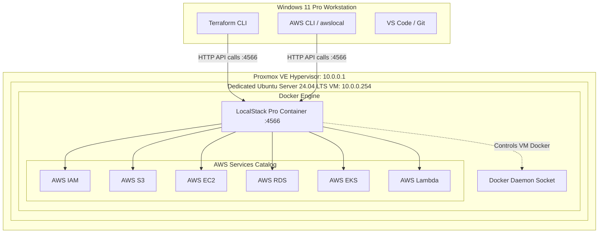

# AWS Mastery Lab: Enterprise Cloud Architecture on LocalStack & Proxmox


An enterprise-grade, reproducible AWS hands-on laboratory designed to build deep, production-level expertise in **AWS Cloud Architecture**, **Security**, and **Infrastructure as Code (IaC)** with **Terraform**, running locally against a dedicated **LocalStack Pro** instance hosted on a private **Proxmox VE** hypervisor node.

> [!NOTE]
> **Lab Security Notice & Disclaimer:**  
> All credentials, access keys (`AWS_ACCESS_KEY_ID`), secrets, and account IDs shown or generated in this repository (such as `generated_credentials.json`) are completely **fictitious mock values** created specifically for this local, isolated LocalStack environment. They carry **zero validity, access, or security exposure** against real AWS public cloud infrastructure.

---

## Architecture Overview



---

## Motivation & Principles

1. **Zero Cloud Bill, 100% Industry Parity:** Provision production-ready AWS resources using the official HashiCorp AWS provider without incurring cloud billing or fear of lingering resources.
2. **Dedicated Homelab Computing:** Offload compute, container runtimes (EC2 emulation), and Kubernetes clusters (EKS) to an isolated Proxmox VM node (`10.0.0.254`) keeping the workstation clean.
3. **AWS Well-Architected Framework:** Every module strictly adheres to AWS security, reliability, and modular IaC best practices.

---

## Lab Curriculum & Modules

- [x] **Module 01: IAM & Cloud Security Foundation** (Current)
- [ ] **Module 02: Core Networking & VPC Design** (VPC, Public/Private Subnets, Route Tables, Internet Gateways, Security Groups)
- [ ] **Module 03: Compute & IaaS** (EC2 instances with automated `user_data` bootstrapping, AMIs, Key Pairs)
- [ ] **Module 04: Storage & Data Engineering** (S3 Buckets, Bucket Policies, Lifecycle Rules, CORS)
- [ ] **Module 05: Serverless & Event-Driven Architecture** (API Gateway, AWS Lambda, DynamoDB, SQS/SNS)
- [ ] **Module 06: Managed Containers & Kubernetes** (Amazon EKS, Helm charts, Ingress Controllers)

---

## Module 01: Identity and Access Management (IAM)

### Theoretical Foundation
* **The Root Account Quarantine Rule:** The AWS Root account is only intended for initial setup, billing, and emergency account recovery. Daily engineering tasks must **never** be performed via the root credentials.
* **IAM Groups vs Individual Assignment:** Applying policies directly to individual users introduces configuration drift and permission sprawl. Permissions are bound to an **IAM Group**, and users gain rights exclusively via **Group Membership**.
* **Policy Anatomy:**
  * `Effect`: Explicitly `Allow` or `Deny`.
  * `Action`: API calls permitted (e.g., `s3:GetObject`, `ec2:RunInstances` or `*`).
  * `Resource`: Target Amazon Resource Names (ARNs).

### Resources Provisioned
* `aws_iam_group.administrators`: Administrative group (`cloud-administrators`).
* `aws_iam_user.admin_user`: Dedicated administrative user (`admin-luis`).
* `aws_iam_group_membership.admin_team`: Association between user and group.
* `aws_iam_policy.admin_policy`: Customer-managed Administrator policy document.
* `aws_iam_group_policy_attachment.attach_admin_policy`: Link binding the policy to the group.
* `aws_iam_access_key.admin_key`: Programmatic Access Key ID & Secret Access Key for CLI/SDK access.
* `local_file.admin_credentials`: Automated JSON export of generated credentials for lab testing.

---

## Getting Started

### 1. Prerequisites
* **Terraform CLI** `>= 1.5.0`
* **AWS CLI v2**
* Reachable LocalStack Pro instance running at `http://10.0.0.254:4566`

### 2. Initialization & Deployment
Navigate to the IAM module folder and apply the configuration:

```bash
# Navigate to the IAM module directory
cd IAM

# Initialize Terraform and download the official HashiCorp AWS provider
terraform init

# Review the execution plan (6 resources to be created)
terraform plan

# Apply the infrastructure changes
terraform apply -auto-approve
```

### 3. Workstation AWS CLI Configuration

To communicate with your private cloud using standard `aws` commands without needing `--endpoint-url` on every call, configure your local AWS profile:

#### Option A: Automated Configuration Wizard (Recommended)
Run the bundled PowerShell script from the repository root:

```powershell
.\scripts\configure_aws_cli.ps1
```
* Automatically detects and loads keys from `IAM/generated_credentials.json`.
* Configures `~/.aws/credentials` and `~/.aws/config` with the `endpoint_url` directive.
* Validates connection with `aws iam list-users`.

#### Option B: Manual Configuration
Create or edit your AWS CLI configuration files:

**`~/.aws/credentials`** (Windows: `C:\Users\<user>\.aws\credentials`):
```ini
[default]
aws_access_key_id = <YOUR_ACCESS_KEY_ID>
aws_secret_access_key = <YOUR_SECRET_ACCESS_KEY>
```

**`~/.aws/config`** (Windows: `C:\Users\<user>\.aws\config`):
```ini
[default]
region = us-east-1
output = json
endpoint_url = http://10.0.0.254:4566
```

> **Pro Tip:** In AWS CLI v2, the `endpoint_url` setting in `~/.aws/config` instructs the CLI to route all API calls to your LocalStack server automatically. You never have to type `--endpoint-url` again!

---

### 4. Verification & CLI Inspection
With your profile configured, interact with your cloud exactly like production AWS:

```bash
# List all IAM users
aws iam list-users

# List all IAM groups
aws iam list-groups

# View group membership for admin-luis
aws iam get-group --group-name cloud-administrators

# Verify attached policies
aws iam list-attached-group-policies --group-name cloud-administrators
```

---

## Author
**Luis B.** — Cloud & DevOps Engineering Lab Portfolio
